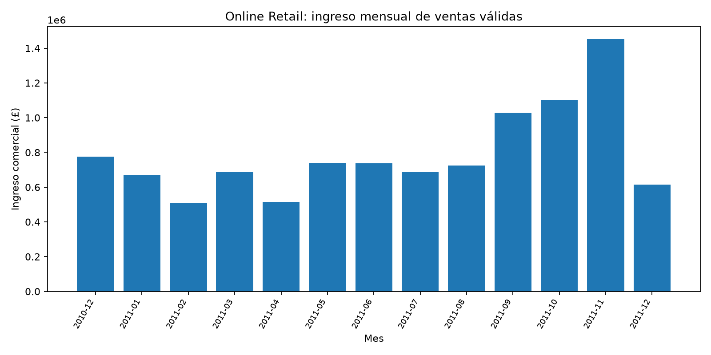
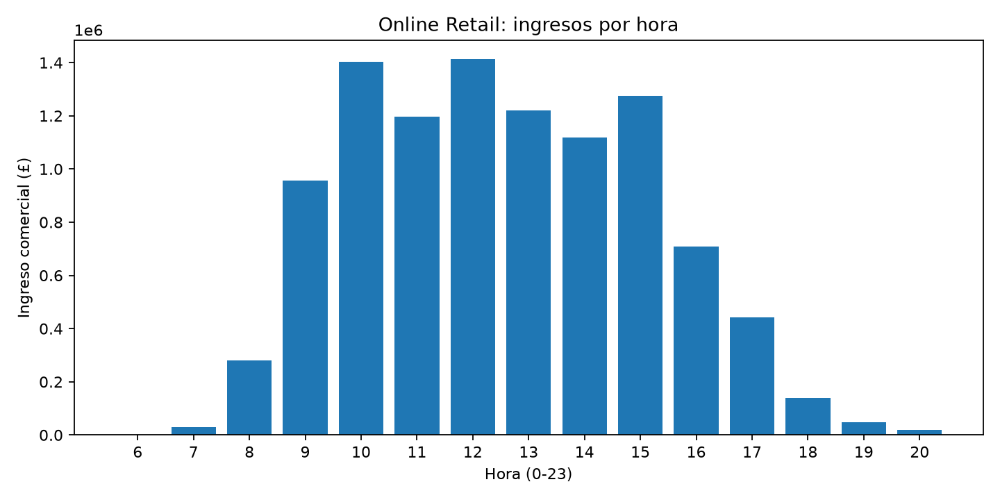
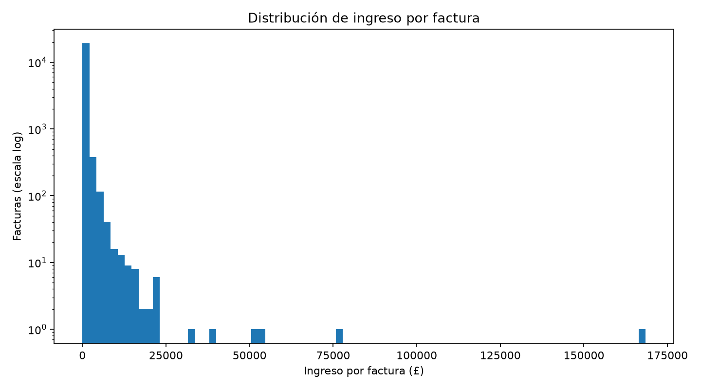

# Universidad del Bío-Bío
## Facultad de Ciencias — Departamento de Estadística
# Evaluación N°1: ¿Cuánto vende realmente una tienda en línea?
**Auditoría de ventas reales desde la línea de comandos**  
**Asignatura:** Ciencia de Datos en la Terminal Linux  
**Profesor:** Luis Gómez  
**Analista:** Juan Pablo Vargas  
**Fecha:** 22 de octubre de 2026

---

## Índice
1. Resumen ejecutivo  
2. Fuente y metodología  
3. Auditoría y limpieza  
4. Análisis exploratorio  
5. Modelación predictiva  
6. Hallazgos y conclusiones  
7. Reproducibilidad y referencias

## 1. Resumen ejecutivo
Se procesaron **541,909** registros del comercio electrónico británico Online Retail. Tras una auditoría excluyente quedaron **522,568** líneas de venta válidas y **19,341** observaciones separadas. El ingreso comercial válido suma **£10,247,905.13**. Las cancelaciones negativas registradas, en valor absoluto, suman **£893,979.73** (**8.02%** del bruto operativo definido en esta auditoría).
## 2. Fuente y metodología
Fuente: Chen, D. (2015). *Online Retail* [Dataset]. UCI Machine Learning Repository. https://archive.ics.uci.edu/dataset/352/online+retail. Registros entre el 01-12-2010 y el 09-12-2011. Se descargó ZIP con `curl -L`, se extrajo con `unzip`, se convirtió la planilla mediante `in2csv`, se verificaron dimensiones con `wc -l` y tipos/distribuciones con `csvstat`, y se procesó el CSV con un script invocado desde la terminal. Los gráficos fueron generados con matplotlib mediante Python.
**Convenciones:** Revenue = Quantity × UnitPrice (libras esterlinas); Month = AAAA-MM; Hour = 0–23; CustomerID se normaliza a entero sin decimal; InvoiceDate conserva hora y segundos. Los duplicados se comparan antes de normalizar texto, para detectar duplicados exactos en la fuente. Se estandariza Description a mayúsculas y espacios simples, evitando diferencias de presentación.
## 3. Auditoría y limpieza
### 3.1 Faltantes en la fuente
| Columna | Faltantes | % de filas |
|---|---|---|
| InvoiceNo | 0 | 0.00% |
| StockCode | 0 | 0.00% |
| Description | 1454 | 0.27% |
| Quantity | 0 | 0.00% |
| InvoiceDate | 0 | 0.00% |
| UnitPrice | 0 | 0.00% |
| CustomerID | 135080 | 24.93% |
| Country | 0 | 0.00% |

**Contraste con UCI:** la ficha describe Description y CustomerID como atributos que pueden faltar. Los conteos anteriores se obtienen directamente del archivo descargado y permiten comprobar la magnitud. No se presupone que la ficha contenga los conteos exactos.
No se descartan ventas con **CustomerID faltante**: la venta y su ingreso se conocen incluso si no se conoce al comprador. Se conservan 131,418 ventas válidas sin identificador, equivalentes a £1,510,677.49; se excluyen únicamente del archivo de clientes para modelación. Los registros sin **Description** se separan del conjunto comercial para que los rankings de productos sean interpretables; esta es una decisión conservadora que puede subestimar el ingreso si hay transacciones genuinas sin descripción.
### 3.2 Anomalías detectadas (conteo independiente; se superponen)
| Detección | Filas |
|---|---|
| Duplicados exactos | 5268 |
| Facturas C (filas) | 9288 |
| Quantity <= 0 o inválida | 10624 |
| UnitPrice <= 0 o inválido | 2517 |
| Códigos no comerciales | 2916 |
| Description faltante | 1454 |
| CustomerID faltante | 135080 |
| Valores atípicos Quantity (IQR) | 58619 |
| Valores atípicos UnitPrice (IQR) | 39627 |

Outliers: regla descriptiva de Tukey (valores por debajo de Q1−1.5×IQR o por encima de Q3+1.5×IQR), calculada con la distribución cruda de cada variable. **No se excluyen por ser extremos**: una compra mayorista puede ser legítima; las magnitudes originales se conservan en el análisis de sensibilidad.
- **Quantity:** umbral inferior -12.50; superior 23.50.
- **UnitPrice:** umbral inferior -3.07; superior 8.45.
### 3.3 Exclusión secuencial y rastreable
Cada registro recibe **un único motivo prioritario**; los conteos de la siguiente tabla sí son aditivos. Se evita descontar dos veces una factura C con cantidad negativa.
| Paso | Filas excluidas en este paso | Filas restantes |
|---|---|---|
| Duplicado exacto | 5,268 | 536,641 |
| Cancelación | 9,251 | 527,390 |
| Cantidad inválida o <= 0 | 1,336 | 526,054 |
| Precio inválido o <= 0 | 1,176 | 524,878 |
| Código no comercial | 2,310 | 522,568 |
| Descripción faltante | 0 | 522,568 |
| Fecha inválida | 0 | 522,568 |

**Resultado:** 522,568 ventas comerciales; 19,341 excluidas guardadas en `data/retail_anulaciones.csv` con columna `ExclusionReason`.
Criterios: duplicado exacto (evita facturación doble); factura que comienza en C (cancelación, nunca venta nueva); cantidad y precio no positivos o inválidos (no representan ventas comerciales positivas); códigos `POST`, `DOT`, `M`, `D`, `C2`, `BANK CHARGES`, `AMAZONFEE`, `S`, `B`, `CRUK`, `PADS` (portes, comisiones, descuentos, ajustes o líneas especiales no tratadas como producto comercial); descripción ausente (producto no interpretable) y fecha ilegible (impide desagregar por mes/hora). **Advertencia:** algunos códigos especiales pueden representar operaciones reales; su exclusión define estrictamente ingresos por productos, no ingresos contables totales.
## 4. Análisis exploratorio
### 4.1 Distribuciones y asimetría
| Variable | Media | Mediana | DE | Mínimo | Q1 | Q3 | Máximo | Asimetría |
|---|---|---|---|---|---|---|---|---|
| Quantity | 10.64 | 4.00 | 156.59 | 1.00 | 1.00 | 12.00 | 80,995.00 | 468.82 |
| UnitPrice | 3.28 | 2.08 | 4.40 | 0.04 | 1.25 | 4.13 | 649.50 | 25.69 |
| Revenue | 19.61 | 9.90 | 269.93 | 0.06 | 3.90 | 17.70 | 168,469.60 | 515.96 |

Asimetría positiva: abundan compras de menor cuantía y algunas líneas muy grandes arrastran el promedio. La mediana permite describir la transacción típica sin el fuerte impacto de las colas. Los valores extremos no deben confundirse automáticamente con errores.
### 4.2 Magnitud de ventas y cancelaciones
- Ingreso de ventas válidas: **£10,247,905.13**.
- Valor absoluto de cancelaciones negativas: **£893,979.73**. 
- Bruto operativo definido = ventas válidas + cancelaciones absolutas: **£11,141,884.86**. 
- Porcentaje anulado = |cancelaciones C negativas| / bruto operativo: **8.02%**. 
- Facturas distintas: **19,773**; clientes identificados: **4,334**; códigos de producto distintos: **3,912**.
**Alcance del indicador:** no es una pérdida causal ni financiera auditada: una factura C puede devolver una venta anterior al período; las cancelaciones pueden tener precios o productos distintos. No se deduce que todo lo cancelado equivalga a ingreso recuperable.
### 4.3 Productos líderes
| Posición | Código | Descripción | Ingreso £ |
|---|---|---|---|
| 1 | 22423 | REGENCY CAKESTAND 3 TIER | 174,156.54 |
| 2 | 23843 | PAPER CRAFT , LITTLE BIRDIE | 168,469.60 |
| 3 | 85123A | CREAM HANGING HEART T-LIGHT HOLDER | 104,462.75 |
| 4 | 47566 | PARTY BUNTING | 99,445.23 |
| 5 | 85099B | JUMBO BAG RED RETROSPOT | 94,159.81 |
| 6 | 23166 | MEDIUM CERAMIC TOP STORAGE JAR | 81,700.92 |
| 7 | 23084 | RABBIT NIGHT LIGHT | 66,870.03 |
| 8 | 22086 | PAPER CHAIN KIT 50'S CHRISTMAS | 64,875.59 |
| 9 | 84879 | ASSORTED COLOUR BIRD ORNAMENT | 58,927.62 |
| 10 | 79321 | CHILLI LIGHTS | 54,096.36 |

**Top 10 por unidades:**
| Posición | Código | Descripción | Unidades |
|---|---|---|---|
| 1 | 23843 | PAPER CRAFT , LITTLE BIRDIE | 80,995.00 |
| 2 | 23166 | MEDIUM CERAMIC TOP STORAGE JAR | 78,033.00 |
| 3 | 22197 | POPCORN HOLDER | 56,898.00 |
| 4 | 84077 | WORLD WAR 2 GLIDERS ASSTD DESIGNS | 54,951.00 |
| 5 | 85099B | JUMBO BAG RED RETROSPOT | 48,371.00 |
| 6 | 85123A | CREAM HANGING HEART T-LIGHT HOLDER | 37,641.00 |
| 7 | 21212 | PACK OF 72 RETROSPOT CAKE CASES | 36,396.00 |
| 8 | 84879 | ASSORTED COLOUR BIRD ORNAMENT | 36,362.00 |
| 9 | 23084 | RABBIT NIGHT LIGHT | 30,739.00 |
| 10 | 22492 | MINI PAINT SET VINTAGE | 26,633.00 |

Los dos top 10 comparten **6** códigos; mayor volumen no garantiza mayor ingreso: el precio unitario cambia la posición de un producto.
### 4.4 Distribución geográfica y temporal
**Ingreso por país (todos los países):**
| País | Ingreso (£) | % de total |
|---|---|---|
| United Kingdom | 8,725,129.48 | 85.14% |
| Netherlands | 283,889.34 | 2.77% |
| EIRE | 270,850.86 | 2.64% |
| Germany | 205,381.15 | 2.00% |
| France | 184,493.00 | 1.80% |
| Australia | 138,103.81 | 1.35% |
| Spain | 55,706.56 | 0.54% |
| Switzerland | 53,065.60 | 0.52% |
| Japan | 37,416.37 | 0.37% |
| Belgium | 36,927.34 | 0.36% |
| Sweden | 36,828.83 | 0.36% |
| Norway | 32,454.64 | 0.32% |
| Portugal | 26,951.11 | 0.26% |
| Channel Islands | 19,997.54 | 0.20% |
| Finland | 18,344.88 | 0.18% |
| Denmark | 18,211.34 | 0.18% |
| Italy | 15,820.24 | 0.15% |
| Cyprus | 13,167.16 | 0.13% |
| Hong Kong | 9,744.19 | 0.10% |
| Singapore | 9,120.39 | 0.09% |
| Austria | 8,742.68 | 0.09% |
| Israel | 8,129.41 | 0.08% |
| Poland | 6,974.65 | 0.07% |
| Unspecified | 4,740.94 | 0.05% |
| Greece | 4,425.52 | 0.04% |
| Iceland | 4,310.00 | 0.04% |
| USA | 3,580.39 | 0.03% |
| Canada | 3,115.44 | 0.03% |
| Malta | 2,070.59 | 0.02% |
| United Arab Emirates | 1,864.78 | 0.02% |
| Lebanon | 1,693.88 | 0.02% |
| Lithuania | 1,661.06 | 0.02% |
| European Community | 1,159.25 | 0.01% |
| Brazil | 1,143.60 | 0.01% |
| RSA | 1,002.31 | 0.01% |
| Czech Republic | 786.74 | 0.01% |
| Bahrain | 754.14 | 0.01% |
| Saudi Arabia | 145.92 | 0.00% |

**Ingreso por mes:**
| Mes | Ingreso (£) |
|---|---|
| 2010-12 | 775,714.95 |
| 2011-01 | 670,439.46 |
| 2011-02 | 507,866.54 |
| 2011-03 | 689,841.84 |
| 2011-04 | 515,469.66 |
| 2011-05 | 740,036.33 |
| 2011-06 | 737,683.99 |
| 2011-07 | 688,252.67 |
| 2011-08 | 724,308.16 |
| 2011-09 | 1,028,345.38 |
| 2011-10 | 1,103,330.92 |
| 2011-11 | 1,452,115.98 |
| 2011-12 | 614,499.25 |

**Ingreso por hora:**
| Hora | Ingreso (£) |
|---|---|
| 6 | 4.25 |
| 7 | 30,469.21 |
| 8 | 279,297.68 |
| 9 | 955,760.16 |
| 10 | 1,401,791.40 |
| 11 | 1,196,812.55 |
| 12 | 1,412,921.32 |
| 13 | 1,220,426.07 |
| 14 | 1,119,717.34 |
| 15 | 1,274,031.65 |
| 16 | 708,699.81 |
| 17 | 440,964.88 |
| 18 | 139,079.12 |
| 19 | 49,098.66 |
| 20 | 18,831.03 |

**Dominio geográfico:** United Kingdom lidera con 85.14% del ingreso válido. Este peso afecta la representatividad de comparaciones internacionales.
### 4.5 Facturas, concentración y correlaciones
Ingreso por factura: mediana **£302.20**, media **£518.28**, Q1 **£151.68**, Q3 **£481.49** y máximo **£168,469.60**. Los 10 clientes identificados de mayor ingreso aportan **14.83%** del ingreso comercial total (incluidas las líneas de clientes sin ID en el denominador).

| Variable | Quantity | UnitPrice | Revenue |
|---|---|---|---|
| Quantity | 1.0000 | -0.0221 | 0.9156 |
| UnitPrice | -0.0221 | 1.0000 | 0.0613 |
| Revenue | 0.9156 | 0.0613 | 1.0000 |

Son correlaciones lineales sobre filas de venta; Revenue es producto de Quantity y UnitPrice, de modo que la interpretación no es causal y los atípicos pueden dominar el coeficiente.
## 5. Modelación predictiva por cliente
Se agregaron exactamente **4,334** clientes con identificador en `data/clientes.csv`, con columnas `CustomerID, Facturas, Productos, EsUK, MesPrimeraCompra, Ingreso`. `Facturas` y `Productos` cuentan valores distintos; `EsUK` es 1 para UK y 0 para otros; la primera compra se determina con la menor fecha-hora. Ante países múltiples se usa el país modal. La partición 70/30 reproduce la instrucción de la pauta: orden numérico, `shuf --random-source=<(yes 42)` y corte exacto por líneas: **3,033** entrenamiento / **1,301** prueba.
**Importante:** el objetivo Ingreso y los predictores de actividad se calculan sobre el mismo horizonte anual. Esto mide asociación explicativa y no predicción anticipada a la primera compra; para predicción futura se deben construir predictores usando solo información anterior al período objetivo.
### 5.1 Comparación de cinco configuraciones
| Modelo | Objetivo al entrenar | MAE (£) | R² prueba |
|---|---|---|---|
| Base: media de entrenamiento | Original | 2,338.53 | -0.0002 |
| A: Facturas + Productos | Original | 1,464.32 | 0.3039 |
| A: Facturas + Productos | log(1+Ingreso) | 837,643,522.86 | -8109659353967.7607 |
| B: EsUK + MesPrimeraCompra | Original | 2,350.96 | 0.0074 |
| B: EsUK + MesPrimeraCompra | log(1+Ingreso) | 1,824.69 | -0.0161 |

**Mejor MAE de prueba:** A: Facturas + Productos, objetivo **Original**, MAE **£1,464.32**; su R² es **0.3039**. El MAE calcula errores en libras y siempre en escala original. Predicciones negativas se truncan a cero tanto con objetivo original como logarítmico.
**Interpretación de los errores:** el gasto está concentrado en pocos clientes; el 1% superior de clientes en prueba concentra 37.30% de su ingreso. Esos casos elevan el MAE y pueden deteriorar mucho el R². Entrenar con `log(1+Ingreso)` reduce la influencia de valores extremos en el ajuste; volver con `exp(pred)−1` prioriza típicamente el gasto central, pero puede subestimar compradores de gran volumen. El desempeño de B cuantifica cuánta señal contienen país y primer mes sin variables de actividad; si es peor que A, por sí solos resultan menos informativos. Un R² calculado una sola vez es frágil por el peso desproporcionado de pocos compradores grandes y la variabilidad de la muestra de prueba; sería preferible contrastarlo con múltiples particiones o validación cruzada.
## 6. Tres hallazgos y recomendación
1. **Concentración geográfica:** United Kingdom aporta 85.14% del ingreso de líneas válidas.
2. **Importancia de cancelaciones:** £893,979.73 se registran como cancelaciones negativas (8.02% del bruto operativo definido).
3. **Concentración por cliente:** los 10 clientes más grandes explican 14.83% del ingreso comercial registrado.
**Recomendación a la tienda:** monitorear mensualmente cancelaciones por motivo, ventas de los principales productos y concentración de clientes; separar operaciones no comerciales de ventas de artículos. Antes de desplegar pronósticos operativos, separar temporalmente las compras para evitar fuga de información y validar modelos de manera repetida, especialmente en clientes de gasto alto.
## 7. Reproducibilidad y referencias
En una terminal Ubuntu: `sudo apt install -y python3 python3-venv python3-pip curl unzip` y desde la raíz del repositorio ejecutar `bash scripts/pipeline.sh`. Se descargan los datos desde UCI, se corre `in2csv`, `csvstat`, el script de limpieza, la división exacta con `shuf`, los modelos, la factura y este reporte en Markdown y PDF. Se requieren conexión a Internet y paquetes `requirements.txt` en la primera ejecución.
**Archivos:** `data/retail_clean.csv`, `data/retail_anulaciones.csv`, `data/clientes.csv`, `data/train.csv`, `data/test.csv`, `report/modelos.json`, `report/resultados.json`, `report/factura.txt`, `report/reporte.md`, `report/reporte.pdf` y tres figuras PNG.
**Referencia:** Chen, D. (2015). Online Retail. UCI Machine Learning Repository. https://doi.org/10.24432/C5BW33. Ficha: https://archive.ics.uci.edu/dataset/352/online+retail.
